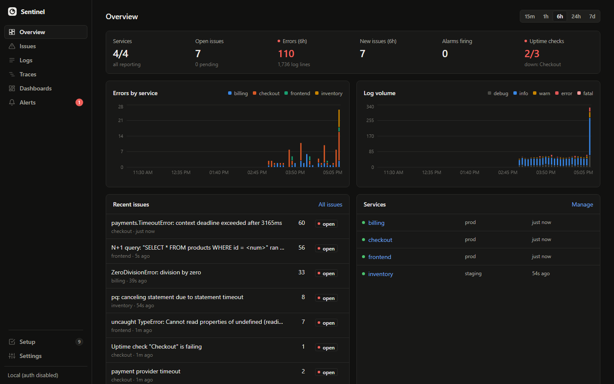
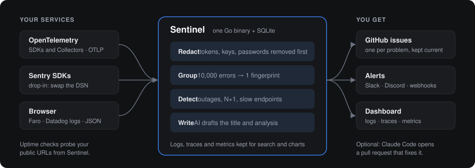
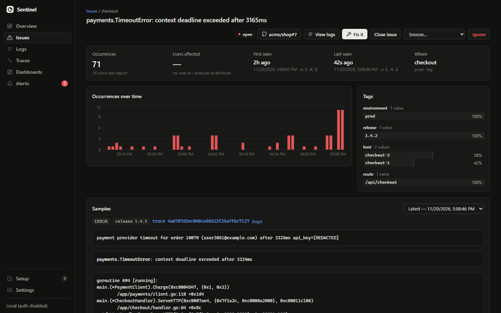
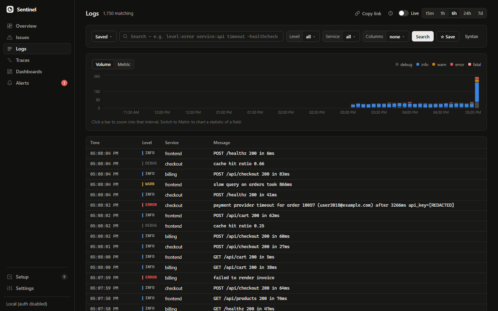
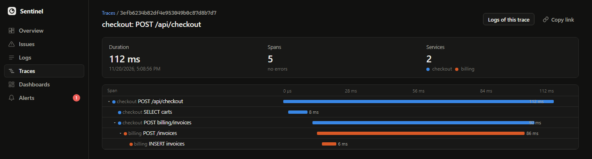
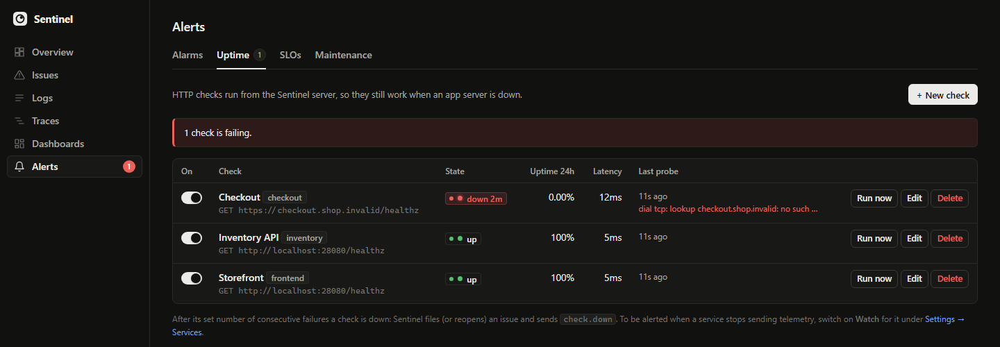

<h1 align="center">Sentinel</h1>

<p align="center">
  <b>Self-hosted error tracking for OpenTelemetry that files one GitHub issue per real problem, not one per log line.</b>
</p>

<p align="center">
  <a href="#try-it-in-one-minute">Try it</a> ·
  <a href="#host-it-in-three-steps">Host it</a> ·
  <a href="#connect-your-servers">Connect your servers</a> ·
  <a href="#documentation">Docs</a>
</p>

<p align="center">
  
</p>

Send Sentinel your logs, traces and metrics. It finds errors, outages and slow
endpoints, groups them, and keeps **one GitHub issue up to date for each
distinct problem**. 10,000 timeouts make one issue, not 10,000. A small AI model
writes the title and analysis, while every fact in the issue (counts,
timestamps, trace IDs, samples) comes from Sentinel itself.

It is **one Go binary with SQLite**. You don't need Kafka, ClickHouse or
Elasticsearch, and you finish setting it up in the browser.

<p align="center">
  
</p>

## Try it in one minute

You only need Docker. This starts Sentinel with four fake services sending
traffic. No GitHub account, sign-in or AI key is needed.

```bash
git clone https://github.com/weeklyvillain/sentinel.git && cd sentinel
docker compose -f deploy/docker-compose.demo.yml up --build
```

Open **<http://localhost:8080>**. Within a minute you'll see issues being
grouped. After 90 seconds one service goes quiet, so you can watch outage
detection, and halfway through, checkout ships a slower release. GitHub
calls are only logged in this mode.

<details>
<summary>Without Docker (Go 1.26+)</summary>

```bash
go build -o bin/sentinel ./cmd/sentinel
INGEST_TOKEN=demo SENTINEL_HTTP_ADDR=127.0.0.1:8080 DRY_RUN=true DASHBOARD_AUTH=none AI_PROVIDER=none ./bin/sentinel
```

In a second terminal:

```bash
go run ./cmd/sentinel-demo -endpoint http://localhost:4318 -token demo
```

</details>

## What you get

<table>
  <tr>
    <td width="50%"></td>
    <td width="50%"></td>
  </tr>
  <tr>
    <td><b>Issues that stay quiet.</b> One per fingerprint, with occurrences, releases, tags and samples. A fixed error that comes back is reopened as a <i>Regression</i>.</td>
    <td><b>Log search.</b> Every line, redacted and searchable, with live tail, saved searches and charts of any field.</td>
  </tr>
  <tr>
    <td></td>
    <td></td>
  </tr>
  <tr>
    <td><b>Traces across services.</b> Waterfalls, per-endpoint latency, N+1 queries and slow-release detection.</td>
    <td><b>Uptime and outages.</b> HTTP checks and services that go quiet open an issue, notify Slack or Discord, and close it with the outage length when they recover.</td>
  </tr>
</table>

Also included: custom metric dashboards, alarms, SLOs with burn-rate alerts,
maintenance windows, Sentry SDKs as a drop-in (just swap the DSN), and
optional **automated fixes**, where Claude Code opens a pull request that
says `Fixes #N`.

## Host it in three steps

Run Sentinel on its **own** small server, not on the machines it watches, so
it can still tell you when they go down. Any Linux VM with Docker works.

**1. Point a domain at the server.** Create a DNS record such as
`sentinel.example.com` and open ports **80** and **443**. HTTPS certificates
are automatic.

**2. Run the installer on the server.**

```bash
git clone https://github.com/weeklyvillain/sentinel.git && sentinel/deploy/setup.sh
```

It checks Docker, asks for your domain, starts Sentinel behind Caddy, and
prints something like:

```text
Sentinel is running. Finish in the browser:

    1. Open        https://sentinel.example.com
    2. Enter code  7KQ2-M9XD
    3. Click "Create GitHub App", install it, and sign in.
```

**3. Finish in the browser.** Enter the code and click **Create GitHub App**.
Sentinel registers its own GitHub App, so there are no keys to copy. Then
install the app on your repositories and sign in. **Setup** in the sidebar
walks you through the rest and checks each step for you.

To upgrade, run `deploy/setup.sh` again. Your data and settings are kept.

<details>
<summary>Doing it by hand, or behind an existing reverse proxy</summary>

```bash
cd sentinel/deploy
echo "SENTINEL_DOMAIN=sentinel.example.com" > .env
docker compose up -d --build
docker compose logs sentinel | grep "setup code"
```

If another proxy already owns ports 80 and 443, use
`docker-compose.behind-proxy.yml`. See the
[deployment guide](docs/deployment.md#when-another-proxy-already-owns-80443).

</details>

## Connect your servers

Copy the ingest token from **Settings → Access**, then on each app server:

```bash
cd sentinel/deploy
export SENTINEL_ENDPOINT=https://sentinel.example.com
export SENTINEL_INGEST_TOKEN=<token>
export HOST_SERVICE_NAME=host-$(hostname)
docker compose -f docker-compose.collector.yml up -d
```

This runs an OpenTelemetry Collector that forwards your apps' telemetry,
sends the machine's CPU, memory, disk and network, and buffers on disk while
Sentinel is unreachable. Point your apps at it with:

```bash
OTEL_EXPORTER_OTLP_ENDPOINT=http://localhost:4318
OTEL_SERVICE_NAME=checkout
```

Already using Sentry? Swap the DSN instead. [Sending telemetry](docs/sending-telemetry.md)
covers Sentry SDKs, browser apps, structured logs and an existing Collector.

## Documentation

| | |
|---|---|
| [How it works](docs/how-it-works.md) | Ingest, redaction, grouping, the issue lifecycle, releases, performance and outage detection |
| [First start and sign-in](docs/setup.md) | The setup code, the generated GitHub App, who may sign in, repositories |
| [Deployment](docs/deployment.md) | Docker Compose, behind an existing proxy, collectors, uptime checks, backups |
| [Sending telemetry](docs/sending-telemetry.md) | OpenTelemetry Collector, structured logs, Sentry SDKs, Faro, Datadog and JSON logs |
| [Tracing across services](docs/tracing.md) | How traces link up across OpenTelemetry, Sentry and browser SDKs |
| [Dashboard](docs/dashboard.md) | Logs, traces, issues, dashboards, alarms, uptime, SLOs, webhooks |
| [Automated fixes](docs/automated-fixes.md) | Claude Code in GitHub Actions or the fixer container |
| [Configuration](docs/configuration.md) | Every environment variable, AI providers |
| [Development](docs/development.md) | Building, the UI dev server, tests, end-to-end check, code layout |

## Security

- **Secrets never leave the box.** Tokens, passwords, API keys, JWTs and URL
  credentials are redacted *before* anything is stored, sent to a model or
  posted to GitHub.
- **Sign-in fails closed.** Only the GitHub users and organization you allow
  get in, and you can't save a list that locks yourself out. A fresh install
  can only be claimed by someone who can read the server's log.
- **Ingest needs a token**, which Sentinel generates. Several tokens can be set
  to rotate without downtime.
- The model's prompt treats all telemetry as untrusted data. Its output is
  redacted again, with `@mentions` neutralized, before it is posted.
- Webhook deliveries can be signed with HMAC-SHA256.

Please report vulnerabilities privately through
[GitHub security advisories](https://github.com/weeklyvillain/sentinel/security/advisories/new).

## Contributing

Issues and pull requests are welcome. Run `go test ./... && go vet ./...`
before you open a PR. The built UI in `internal/web/dist` is committed, so
`go build` works without Node. After changing `web/`, rebuild it with
`npm --prefix web ci && npm --prefix web run build`. See
[Development](docs/development.md) for the hot-reload dev server.

## License

[MIT](LICENSE)
